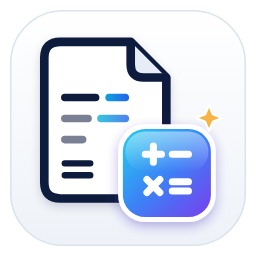

<p align="center">
  
</p>

<h1 align="center">GCP-Calc</h1>

<p align="center">
  <b>Calculadora em notas</b> — escreva cálculos do jeito que você pensa e veja os resultados na hora.<br>
  Moedas e criptomoedas ao vivo, unidades, porcentagens, variáveis, datas, gráficos e um assistente passo a passo.<br>
  Linux (.deb, .rpm, Arch/BigLinux/Omarchy) · Windows · macOS (Intel e Apple Silicon) · Android (.apk)
</p>

<p align="center">
  <a href="https://github.com/cliqueprojeto/GCP-Calc/releases/latest"><b>⬇ Baixar a versão mais recente</b></a>
</p>

---

## ✨ O que ele faz

```
# Orçamento do mês
Aluguel: R$ 1.850                       R$ 1.850,00
Mercado: R$ 1.150 + 10%                 R$ 1.265,00
Internet: R$ 99,90                         R$ 99,90
total                                   R$ 3.214,90

US$ 120 em reais                          R$ 6xx,xx   ← cotação ao vivo
5 km em milhas                             3,1069 mi
45 em % de 180                                   25%
hoje + 45 dias                       sáb., 10 jan. 2027
parcela = pmt(1,2%; 24; R$ 15.000)        R$ 72x,xx
```

- **Linguagem natural em PT, EN e ES** — palavras soltas são ignoradas, números, operadores, unidades e moedas são detectados automaticamente (`Aluguel 1.500 + condomínio 450`).
- **Separadores do seu idioma** — vírgula ou ponto decimal ao digitar e nos resultados (automático pelo idioma ou fixo).
- **Moedas ao vivo** — 160+ moedas (open.er-api.com / BCE), real comercial ao vivo (AwesomeAPI) e criptomoedas (CoinGecko). Atualiza ao abrir o app e quando você pedir.
- **Tags personalizadas** — apelidos (`#verdinha → USD`) ou moedas próprias com cotação fixa (`#milhas = 0,02 BRL`): `10.000 milhas em reais`.
- **Conversor de unidades** — comprimento, massa, área, volume, tempo, temperatura, dados, velocidade de internet, velocidade, energia, potência, pressão, ângulo e frequência, com unidades compostas (`5 ft 3 in em cm`, `100 km / 2 h`, `3 m * 4 m`).
- **Porcentagens** — `300 + 10%`, `20% de 300`, `50 em % de 200`, `20% off 50`.
- **Variáveis e funções** — `salario = R$ 7.500`, rótulos viram variáveis (`Aluguel: 1.500` → `Aluguel * 12`), funções próprias (`f(x) = x^2 + 1`), `total`, `média`, `prev`, `sqrt`, `round`, `log`, trigonometria, `pmt`/`fv`/`pv` (financiamento e investimentos), `mdc`, `mmc`, hexadecimal e binário.
- **Datas** — `hoje + 30 dias`, `25/12/2026 - hoje`.
- **Notas com nome, cor e ícone** — banco com toda a biblioteca Lucide (1.500+ ícones com busca) e emojis; pastas, fixar, lixeira, busca rápida (`Ctrl+K`).
- **Elementos gráficos no bloco** — gráficos (colunas, barras, pizza, rosca, linha) gerados dos próprios cálculos, metas com barra de progresso, painel de cotações, destaques, imagens, adesivos, títulos e divisores.
- **Assistente passo a passo (não é um chat)** — botões contextuais e dinâmicos que vão perguntando (escolhas, número, texto) até gerar as linhas do cálculo, com prévia dos resultados antes de inserir. Funciona **offline** (juros compostos, financiamento, dividir a conta, desconto, variação %, regra de três, conversões, combustível, orçamento 50/30/20, valor da hora) e, com IA configurada, para qualquer pedido.
- **IA de vários provedores** — Anthropic, OpenAI, Google Gemini, Mistral, Groq, DeepSeek, xAI, OpenRouter, Ollama (local) ou qualquer API compatível com OpenAI. Botão **Testar API** lista os modelos e escolhe o melhor.
- **Temas** — premium escuros e claros, **paletas de editores de código no estilo Omarchy** (Tokyo Night, Catppuccin, Gruvbox, Nord, Everforest, Kanagawa, Rosé Pine, Matte Black, Osaka Jade, Ristretto, Dracula, Flexoki, Solarized…), clássicos, seguir o sistema e tema personalizado.
- **Sintaxe colorida como num editor de código** — números, unidades, moedas, operadores, variáveis, funções, palavras-chave, comentários, títulos, rótulos, datas, tags e resultados com cores próprias, **todas configuráveis por tema**.
- **Backup e sincronização no Google Drive** — criptografados de ponta a ponta (AES-256-GCM, chave derivada da sua frase-senha); o Google só recebe dados cifrados. Sincronização automática entre aparelhos e backups datados com rotação — mesma lógica do GCP-Neuro Notas. Backup em arquivo `.gcpcalc` com senha opcional.
- **Atualizações direto das releases do GitHub** — o app confere a versão nova (sempre que abrir, diariamente, semanalmente…), baixa o instalador certo para o seu sistema, confere o SHA-256 e instala.
- **Teclado de operadores no celular** e interface adaptada ao Android (áreas seguras, barra de gestos).
- **Português, inglês e espanhol completos.**

## 📦 Instalação

| Sistema | Arquivo |
|---|---|
| Debian, Ubuntu, Mint, Zorin, Pop!_OS | `gcp-calc_<versão>_amd64.deb` |
| Fedora, openSUSE, RHEL | `gcp-calc-<versão>-1.x86_64.rpm` |
| Arch, BigLinux, Omarchy, Manjaro, EndeavourOS | `gcp-calc-bin-<versão>-1-x86_64.pkg.tar.zst` → `sudo pacman -U arquivo.pkg.tar.zst` |
| Windows 10/11 | `GCP-Calc-<versão>-Windows-x64-Setup.exe` |
| macOS Apple Silicon (M1–M4) | `GCP-Calc-<versão>-macOS-arm64.dmg` |
| macOS Intel | `GCP-Calc-<versão>-macOS-x86_64.dmg` |
| Android 7+ | `GCP-Calc-<versão>-Android.apk` |

Cada arquivo vem com o seu `.sha256` e a release traz `SHA256SUMS.txt`.

> **macOS:** o app não é notarizado pela Apple. Na primeira abertura, clique com o botão direito → **Abrir**.

## ☁️ Google Drive

O build oficial usa os segredos `GOOGLE_CLIENT_ID` e `GOOGLE_CLIENT_SECRET` do repositório (o mesmo tipo de cliente OAuth do GCP-Neuro Notas). Sem eles, cada pessoa pode informar o próprio cliente em **Configurações → Backup e sincronização → Configuração avançada**. Passo a passo em [docs/CLOUD-SETUP.md](docs/CLOUD-SETUP.md).

## 🛠️ Desenvolvimento

Requisitos: Node 22, Rust estável e as dependências do Tauri 2 do seu sistema.

```bash
npm install
npm run tauri dev      # app nativo
npm run dev            # só a interface, no navegador
npm test               # testes do motor de cálculo
npm run tauri build    # instaladores do seu sistema
```

Estrutura:

- `src/engine/` — motor de cálculo (lexer, parser, unidades, moedas, formatação), sem dependências.
- `src/components/` — interface React.
- `src/cloud/` — OAuth com PKCE por loopback, Google Drive (pasta oculta do app) e criptografia.
- `src/ai/` — provedores de IA, protocolo do assistente guiado e assistentes offline.
- `src-tauri/` — núcleo nativo (Rust): dados com gravação atômica, OAuth e atualizador.
- `.github/workflows/release.yml` — gera todas as plataformas quando chega um arquivo em `docs/release-notes/vX.Y.Z.md`.

### Publicar uma versão

1. Atualize a versão em `package.json`, `src-tauri/tauri.conf.json` e `src-tauri/Cargo.toml`.
2. Crie `docs/release-notes/vX.Y.Z.md` e faça o push — o GitHub Actions compila, assina o APK (segredos `ANDROID_KEYSTORE_*`), gera os SHA-256 e publica a release.

## 💜 Apoie

O GCP-Calc é gratuito e sem anúncios. Se ele ajuda no seu dia a dia, considere apoiar pelo **PIX** (botão ♥ dentro do app) ou pelo **[Stripe](https://donate.stripe.com/fZu4gzeBSfhbd7451F6Ri00)**.

---

Desenvolvido por **Bruno Albertini** | [Gestão Cultural Pro](https://gestaoculturalpro.com.br) · Licença GPL-3.0
