<div align="center">


# GCP-Calc

**Calculadora em notas: escreva cálculos como você pensa e veja os resultados na hora — com moedas ao vivo, unidades, porcentagens, variáveis, gráficos e um assistente passo a passo.**

Livre · Gratuito · Sem anúncios · Linux, Windows, macOS e Android

[](https://github.com/cliqueprojeto/GCP-Calc/releases/latest)
[](https://github.com/cliqueprojeto/GCP-Calc/releases)
[](LICENSE)


**[⬇️ Baixar](#️-download-e-instalação)** · **[✨ Recursos](#-recursos)** · **[🖼️ Telas](#️-telas)** · **[📜 Versões](CHANGELOG.md)** · **[❤️ Apoie](#️-apoie-o-projeto)**

🇧🇷 Português · [🇺🇸 English](#-english) · [🇪🇸 Español](#-español)

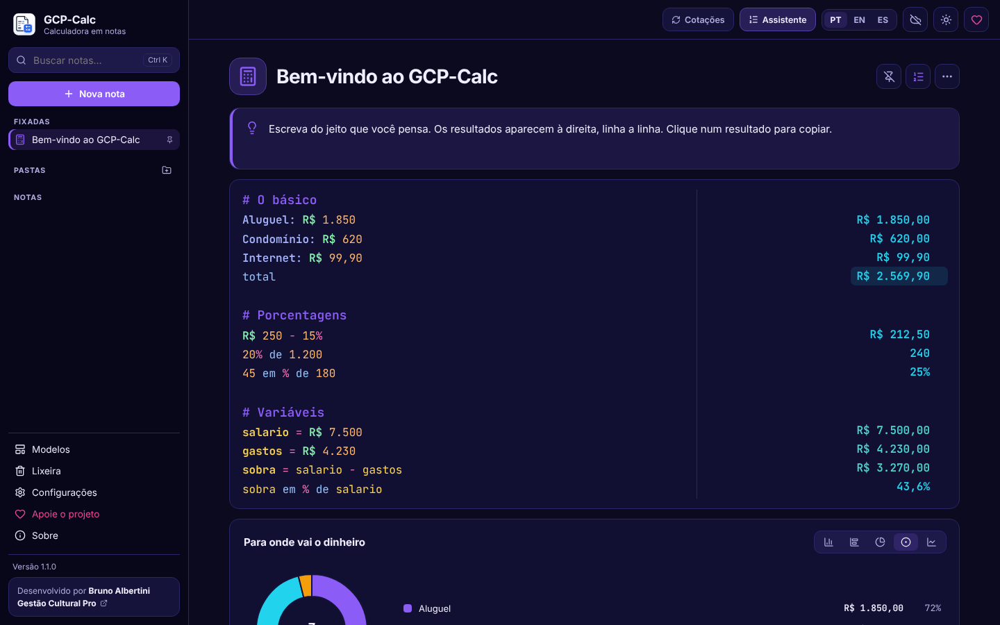

</div>

---

## Sobre

O **GCP-Calc** faz parte da série de aplicativos **GCP** da [Gestão Cultural Pro](https://www.gestaoculturalpro.com.br). É uma calculadora em formato de notas: em vez de apertar teclas, você escreve linhas como `Aluguel: R$ 1.850`, `US$ 120 em reais` ou `5 km em milhas`, e o resultado aparece alinhado à direita, linha a linha, enquanto você digita.

As notas ficam no seu aparelho. Cotações, backup na nuvem, atualizações e IA são opcionais e só são usados quando você liga cada um.

## ✨ Recursos

| | Recurso | Destaques |
|---|---|---|
| 🧮 | **Cálculo em linguagem natural** | Português, inglês e espanhol · palavras soltas são ignoradas (`Aluguel 1.500 + condomínio 450`) · `+ − × ÷ ^ mod !` e também `mais`, `vezes`, `dividido por` · parênteses, multiplicação implícita (`2(3+4)`, `2 pi`) · `3k`, `2 mil`, `1,5 milhão` |
| 🔢 | **Separadores do seu idioma** | Vírgula ou ponto decimal ao digitar e nos resultados (automático pelo idioma ou fixo) · agrupamento de milhares · casas decimais configuráveis |
| 💱 | **Moedas ao vivo** | 160+ moedas (open.er-api.com / BCE), dólar comercial em reais (AwesomeAPI) e criptomoedas (BTC, ETH, SOL…) · símbolos (`R$`, `US$`, `€`, `£`, `¥`), códigos (`100 USD`) e nomes (`50 dólares`) · atualiza ao abrir o app e quando você pedir |
| 🏷️ | **Tags personalizadas** | Apelidos (`#verdinha → USD`) ou moedas próprias com cotação fixa (`#milhas = 0,02 BRL`) · `10.000 milhas em reais` |
| 📏 | **Conversor de unidades** | Comprimento, massa, área, volume, tempo, temperatura, dados, velocidade de internet, velocidade, energia, potência, pressão, ângulo e frequência · unidades compostas (`5 ft 3 in em cm`, `100 km / 2 h`, `3 m * 4 m` → m², `500 Mbps * 1 h em GB`) · medidas de cozinha (xícaras, colheres) |
| ％ | **Porcentagens** | `300 + 10%` · `300 − 10%` · `20% de 300` · `50 em % de 200` · `20% off 50` |
| 🧩 | **Variáveis, rótulos e funções** | `salario = R$ 7.500` · rótulos viram variáveis (`Aluguel: 1.500` → `Aluguel * 12`) · funções próprias (`f(x) = x^2 + 1`) · `total`, `média`, `prev`, `linha3` · `sqrt`, `round`, `log`, `ln`, trigonometria, `mdc`, `mmc`, `min`, `max` · financeiras `pmt` (parcela fixa / Price), `fv` (valor futuro), `pv` · hexadecimal, binário e notação científica |
| 📅 | **Datas** | `hoje + 30 dias` · `25/12/2026 − hoje` · semanas, meses e anos no calendário |
| 🗂️ | **Notas organizadas** | Nome, cor e ícone (banco com toda a biblioteca **Lucide**, 1.500+ ícones com busca, e emojis) · pastas · fixar · lixeira por 30 dias · busca rápida `Ctrl+K` · modelos prontos |
| 📊 | **Elementos gráficos no bloco** | Gráficos de colunas, barras, pizza, rosca e linha gerados dos próprios cálculos · metas com barra de progresso · painel de cotações · destaques coloridos · imagens · adesivos · títulos e divisores |
| 🪄 | **Assistente passo a passo** | Não é um chat paralelo: aparece dentro da nota com botões contextuais e dinâmicos que vão perguntando (escolhas, número, texto) até gerar as linhas do cálculo, com prévia dos resultados antes de inserir |
| 🎨 | **Temas e cores da sintaxe** | Premium escuros e claros · paletas de editores de código no estilo Omarchy · clássicos · seguir o sistema · tema personalizado · cores de números, unidades, moedas, operadores, variáveis, funções, comentários, títulos, rótulos, datas, tags e resultados **configuráveis por tema** |
| 📤 | **Exportação premium** | **PDF** com texto selecionável, fontes embutidas e sintaxe colorida · **Word (.docx)** e **PowerPoint (.pptx)** editáveis, com tabelas e — no PowerPoint — gráficos nativos · **Excel (.xlsx)** organizado: seções, descrições, valores com formato de moeda/%/data, totais como `SUM`/`AVERAGE`, variáveis como nomes definidos e expressões convertidas em fórmulas vivas · Excel com todas as notas e aba de resumo · todos os elementos gráficos (gráficos, metas, destaques, cotações, imagens e adesivos) |
| ☁️ | **Backup e sincronização** | Google Drive criptografado de ponta a ponta (AES-256-GCM) · sincronização automática entre aparelhos · backups datados com rotação · arquivo `.gcpcalc` com senha opcional |
| 🔄 | **Atualizações automáticas** | Direto das Releases do GitHub, com conferência de SHA-256 |

### Assistentes guiados (funcionam offline)

| Finanças | Dia a dia | Conversões |
|---|---|---|
| Juros compostos com aportes · Financiamento (parcelas fixas) · Orçamento 50/30/20 · Valor da hora (freelancer) | Dividir a conta com gorjeta · Desconto e acréscimo · Variação percentual · Regra de três · Combustível da viagem | Unidades (14 grandezas) · Moedas e criptomoedas |

**Comando `/ia` direto na nota:** em qualquer bloco de cálculo, digite `/ia` seguido da pergunta (ex.: `/ia quanto devo investir por mês para dobrar R$ 500?`) e aperte **Enter** — a IA escreve as linhas do cálculo ali mesmo, já calculadas. Se faltar algum dado essencial, o assistente abre com a pergunta dela em botões.

Com uma IA configurada, o assistente aceita qualquer pedido ("quanto juntar por mês para R$ 20 mil em 2 anos?"), explica a nota e revisa os cálculos — sempre com botões e prévia, sem sair da nota. Provedores suportados: **Anthropic, OpenAI, Google Gemini, Mistral, Groq, DeepSeek, xAI, OpenRouter, Ollama (local)** e qualquer API compatível com OpenAI. O botão **Testar API** confere a chave, lista os modelos e escolhe o melhor disponível. Se o provedor estiver sobrecarregado (erros 503/429), o app tenta de novo sozinho e, se preciso, usa outro modelo do mesmo provedor ou outro provedor configurado. A chave fica só no seu aparelho.

### Modelos prontos

Orçamento do mês · Viagem internacional (várias moedas) · Orçamento de projeto cultural (rubricas e limites percentuais) · Proposta de freelance · Receita escalável · Investimentos · Reforma e obra · Conversões rápidas.

### Interface

- Visual premium, coeso com a série GCP, com o mesmo ícone de base branca da família.
- **Português, inglês e espanhol completos**, com detecção automática do idioma do sistema (troca rápida na barra superior).
- Resultado clicável: um clique copia o valor; o rodapé de cada bloco mostra soma e média.
- Teclado de operadores no celular, áreas seguras do Android (barra de status, gestos e teclado).
- Atalhos: `/ia` + Enter pergunta à IA · `Ctrl+K` busca · `Ctrl+N` nova nota · `Ctrl+J` assistente · `Ctrl+,` configurações · `Tab`/`Shift+Tab` recuam linhas.

### Atualizações automáticas

Novas versões chegam direto das [Releases do GitHub](https://github.com/cliqueprojeto/GCP-Calc/releases). Em **Configurações → Atualizações** você escolhe quando verificar:

> Sempre que abrir o programa · Todos os dias · A cada semana · A cada duas semanas · A cada mês · Nunca

Também dá para **verificar agora** e abrir a **página de versões**. Quando há novidade, o aplicativo mostra as notas da versão, baixa o pacote certo para o seu sistema (`.exe`, `.dmg`, `.deb`, `.rpm`, `.pkg.tar.zst` ou `.apk`), confere o SHA-256 e instala.

### Google Drive

Backup e sincronização na pasta oculta do aplicativo no Google Drive (escopo `drive.appdata`): o app não enxerga seus outros arquivos. Tudo é cifrado com AES-256-GCM antes de sair do aparelho, com chave derivada (PBKDF2-SHA256) da frase-senha que você escolhe — o Google só recebe dados ilegíveis. Detalhes em [docs/CLOUD-SETUP.md](docs/CLOUD-SETUP.md).

## ⬇️ Download e instalação

Baixe o arquivo do seu sistema na [página da última versão](https://github.com/cliqueprojeto/GCP-Calc/releases/latest).

| Sistema | Arquivo | Como instalar |
|---|---|---|
| **Windows 10/11** | `GCP-Calc-x.y.z-Windows-x64-Setup.exe` | Dê dois cliques. O aplicativo instala e abre sozinho. |
| **macOS Apple Silicon (M1, M2, M3, M4…)** | `GCP-Calc-x.y.z-macOS-arm64.dmg` | Abra o `.dmg` e arraste o GCP-Calc para **Aplicativos**. |
| **macOS Intel** | `GCP-Calc-x.y.z-macOS-x86_64.dmg` | Abra o `.dmg` e arraste o GCP-Calc para **Aplicativos**. |
| **Debian, Ubuntu, Mint, Zorin, Pop!_OS** | `gcp-calc_x.y.z_amd64.deb` | Dê dois cliques e escolha **Instalar**. |
| **Fedora, openSUSE, RHEL** | `gcp-calc-x.y.z-1.x86_64.rpm` | Dê dois cliques e escolha **Instalar**. |
| **Arch, BigLinux, Omarchy, Manjaro** | `gcp-calc-bin-x.y.z-1-x86_64.pkg.tar.zst` | Dê dois cliques (abre no gerenciador de pacotes) e confirme. |
| **Android 7+** | `GCP-Calc-x.y.z-Android.apk` | Abra o arquivo no celular e permita instalar de fontes desconhecidas. |

Cada arquivo vem com o seu `.sha256`, e a release traz `SHA256SUMS.txt`.

<details>
<summary><b>Instalar pelo terminal (Linux)</b></summary>

```bash
# Debian / Ubuntu / Mint
sudo apt install ./gcp-calc_*_amd64.deb

# Fedora
sudo dnf install ./gcp-calc-*.x86_64.rpm

# Arch / BigLinux / Omarchy / Manjaro
sudo pacman -U gcp-calc-bin-*-x86_64.pkg.tar.zst
```
</details>

<details>
<summary><b>Avisos de segurança no primeiro uso (Windows e macOS)</b></summary>

O GCP-Calc ainda não usa certificados pagos de assinatura de código, por isso o sistema pode exibir um aviso na primeira vez:

- **Windows (SmartScreen):** clique em **Mais informações → Executar assim mesmo**.
- **macOS:** clique com o botão direito no app em Aplicativos → **Abrir** → **Abrir**. Se aparecer "está danificado", rode no Terminal:
  ```bash
  xattr -cr "/Applications/GCP-Calc.app"
  ```
</details>

## 🖼️ Telas

| Moedas ao vivo, unidades, datas e funções | Gráficos gerados dos cálculos |
|---|---|
|  | 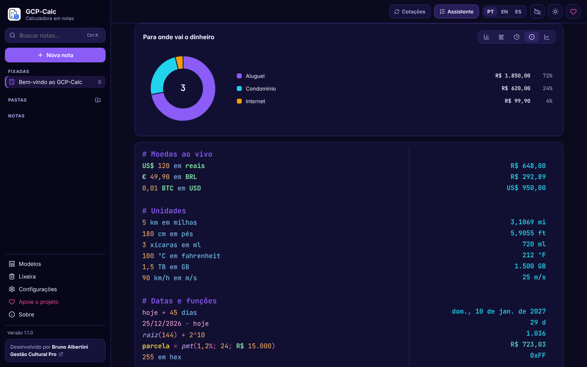 |
| **Assistente passo a passo** | **Assistente guiado: financiamento com prévia** |
|  | 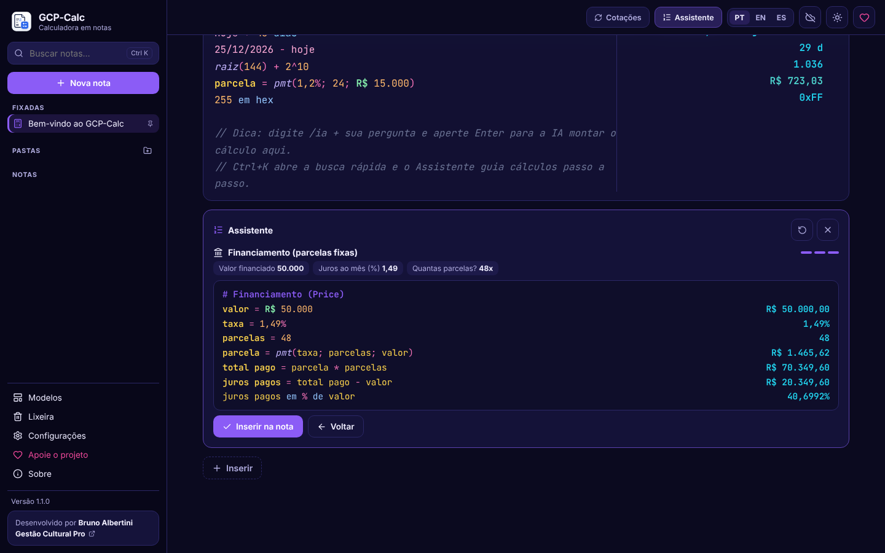 |
| **Modelos prontos** | **Temas premium e de editores de código** |
|  |  |
| **Cores da sintaxe configuráveis (Tokyo Night)** | **Moedas, cotações e tags personalizadas** |
| 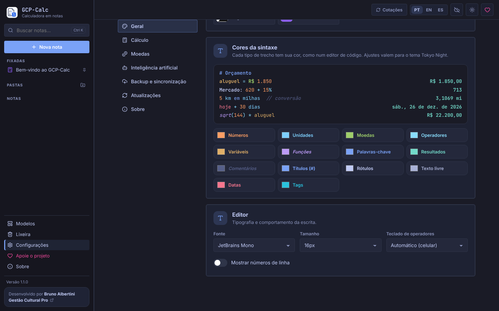 | 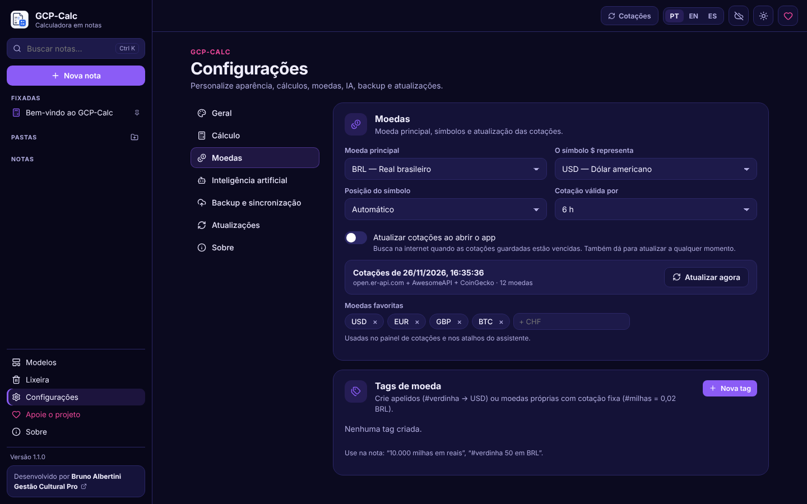 |
| **Provedores de IA com teste de API** | **Backup e sincronização no Google Drive** |
| 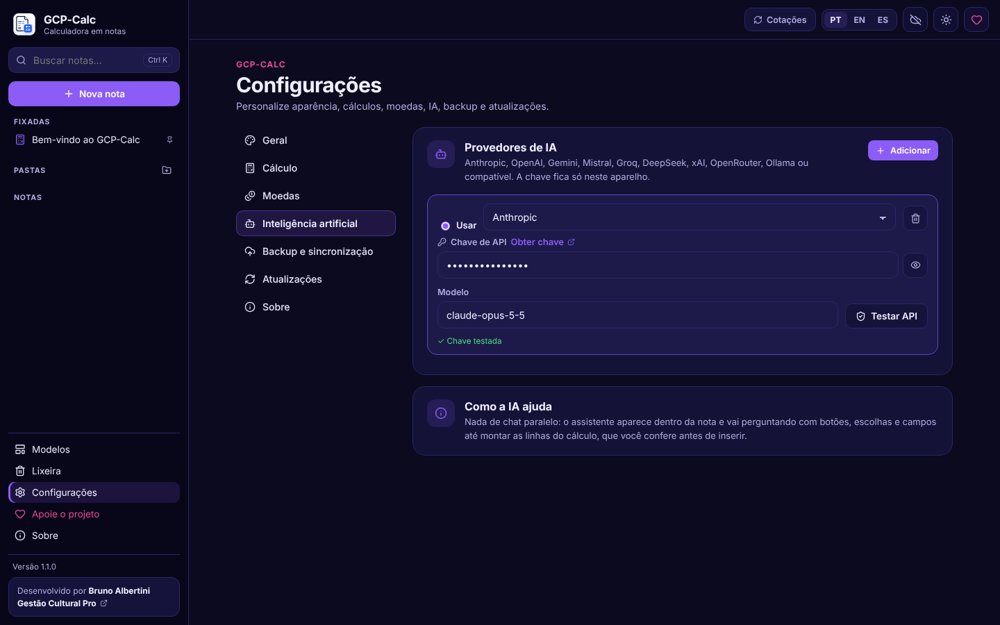 | 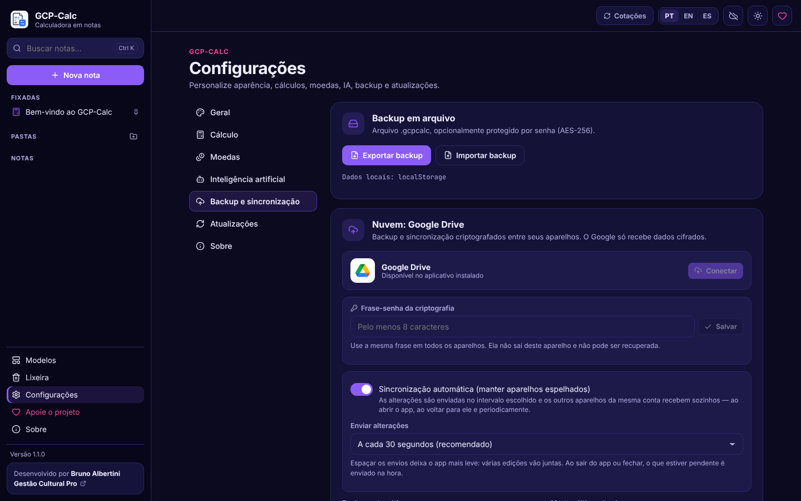 |
| **Atualizações pelo GitHub** | **Apoie o projeto** |
|  |  |
| **Tema claro (inglês)** | **Catppuccin (espanhol)** |
| 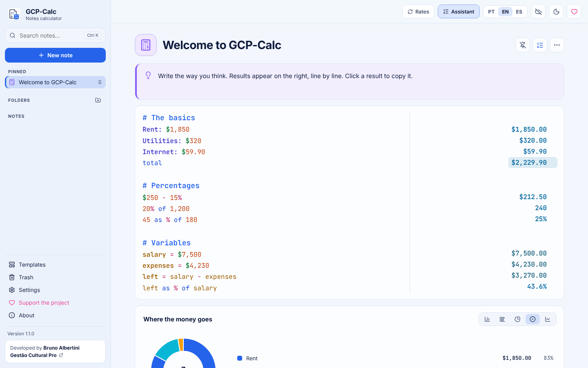 | 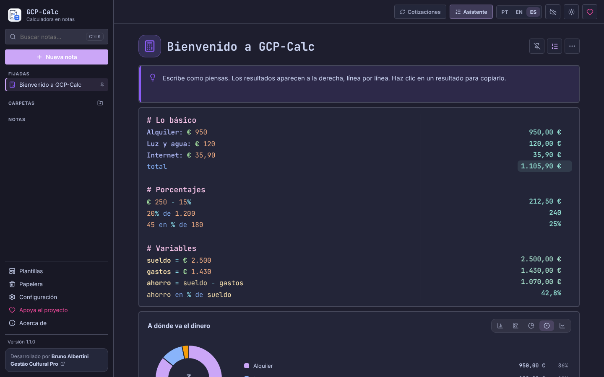 |

<div align="center">

**Android**

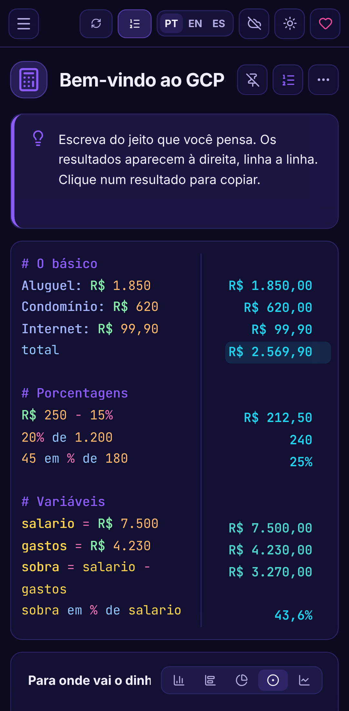&nbsp;&nbsp;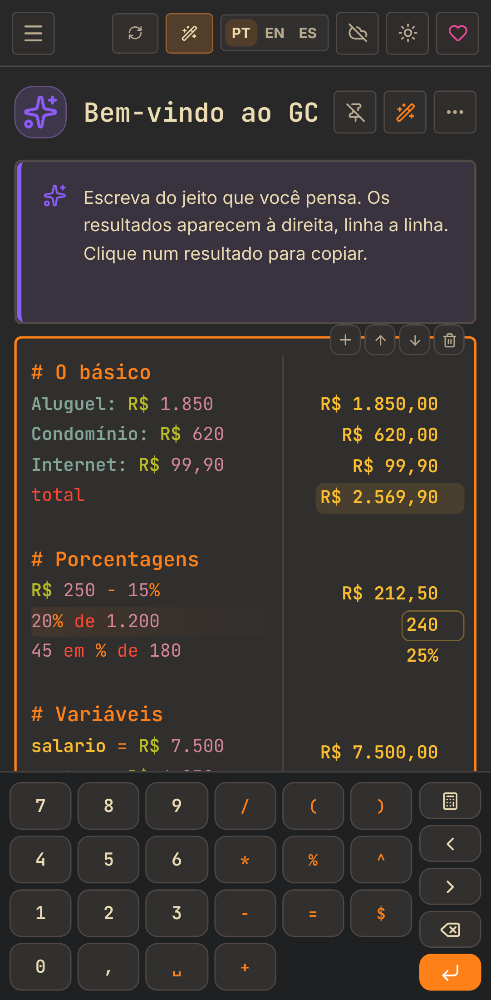

</div>

## 📖 Guia rápido

```
# Títulos começam com #          // comentários com //
Aluguel: R$ 1.500                rótulo + valor (o rótulo vira variável)
x = 10 * 3                       variável
300 + 10%   ·   20% de 300       porcentagens
50 em % de 200                   quanto um valor representa
100 USD em BRL                   moedas ao vivo (e #suas_tags)
5 km em milhas                   unidades
hoje + 30 dias                   datas
total   ·   média   ·   prev     soma, média e resultado anterior do bloco
sqrt(16)   ·   round(3,14159; 2) funções (argumentos separados por ;)
pmt(1%; 24; R$ 10.000)           parcela fixa
f(x) = x^2 + 1                   função própria
255 em hex   ·   0b1010          bases numéricas
```

## 📜 Histórico de versões

As notas completas de cada versão estão no [CHANGELOG.md](CHANGELOG.md) e na [página de Releases](https://github.com/cliqueprojeto/GCP-Calc/releases).

## 🛠️ Desenvolvimento

Requisitos: Node.js 22, Rust estável e as [dependências do Tauri 2](https://tauri.app/start/prerequisites/) do seu sistema.

```bash
git clone https://github.com/cliqueprojeto/GCP-Calc.git
cd GCP-Calc
npm install
npm run tauri dev
```

| Comando | O que faz |
|---|---|
| `npm run tauri dev` | Abre o aplicativo nativo em modo de desenvolvimento |
| `npm run dev` | Abre só a interface no navegador |
| `npm test` | Testes do motor de cálculo, dos modelos e dos assistentes (PT/EN/ES) |
| `npm run typecheck` | Verificação de tipos |
| `npm run tauri build` | Gera os instaladores do seu sistema |
| `node scripts/screenshots.mjs` | Recria as capturas de tela (com `vite preview` na porta 4173) |
| `node scripts/android-icons.mjs` | Recria o ícone adaptativo do Android |

### Publicar uma nova versão

1. Atualize a versão em `package.json`, `src-tauri/tauri.conf.json` e `src-tauri/Cargo.toml`, e adicione a seção no `CHANGELOG.md`.
2. Crie `docs/release-notes/vX.Y.Z.md` e envie para a branch `main`.
3. O GitHub Actions compila para Linux (`.deb`, `.rpm`, `.pkg.tar.zst`), Windows, macOS (Intel e Apple Silicon) e Android, gera os SHA-256 e publica a Release. Os aplicativos instalados detectam a nova versão sozinhos.

Segredos do repositório usados no build: `GOOGLE_CLIENT_ID`, `GOOGLE_CLIENT_SECRET` (Google Drive) e `ANDROID_KEYSTORE_BASE64`, `ANDROID_KEYSTORE_PASSWORD`, `ANDROID_KEY_ALIAS`, `ANDROID_KEY_PASSWORD` (assinatura do APK).

### Estrutura

```
src/
  engine/            motor de cálculo: lexer, parser, unidades, moedas e formatação
  components/        interface (editor, blocos gráficos, assistente, configurações…)
  ai/                provedores de IA, protocolo do assistente e assistentes offline
  cloud/             OAuth com PKCE, Google Drive, sincronização e criptografia
  lib/               temas, ícones, cotações, atualizador e ponte com o sistema
  i18n/              traduções (pt-BR, en, es)
  notes/             nota de boas-vindas e modelos
src-tauri/           núcleo nativo (Rust): dados com gravação atômica, OAuth e atualizações
packaging/           pacote Arch e atividade/ícones do Android
assets/branding/     ícone do aplicativo (SVG/PNG)
scripts/             capturas de tela e ícones
tests/               testes do motor
```

## ❤️ Apoie o projeto

O GCP-Calc é livre e gratuito. Sua contribuição ajuda a mantê-lo aberto e em evolução. Todas as funções estão disponíveis sem contribuição. Também dá para apoiar pelo botão ❤️ dentro do aplicativo.

<table>
<tr>
<td align="center" width="50%">

**PIX · Brasil**


<details><summary>Código PIX copia e cola</summary>

```
00020126850014br.gov.bcb.pix0136e474b71b-7491-4eac-992f-632652e5a4eb0223DEV GESTAO CULTURAL PRO5204000053039865802BR5915BRUNO ALBERTINI6006BRASIL62200516ChromeExtensions63042B27
```
</details>

</td>
<td align="center" width="50%">

**Stripe · Internacional**

Contribua com qualquer valor pelo checkout seguro do Stripe.

**[💜 Contribuir via Stripe](https://donate.stripe.com/fZu4gzeBSfhbd7451F6Ri00)**

</td>
</tr>
</table>

## 📄 Licenças

- **GCP-Calc:** [GNU General Public License v3.0](LICENSE) ou posterior.
- **Componentes de terceiros** (Tauri, React, Zustand, Lucide, jsPDF, docx, PptxGenJS, ExcelJS, node-qrcode, fontes Inter, JetBrains Mono, IBM Plex Mono, Fira Code, Roboto, Atkinson Hyperlegible e outros) e serviços consultados: veja [THIRD_PARTY_NOTICES.md](THIRD_PARTY_NOTICES.md).

As marcas e nomes citados (Google Drive, provedores de IA, paletas de editores etc.) pertencem aos seus titulares e aparecem apenas como referência de compatibilidade.

---

## 🇺🇸 English

**GCP-Calc** is a free, ad-free **notes calculator** for Linux, Windows, macOS (Apple Silicon and Intel) and Android: write calculations the way you think and see results instantly, line by line.

- **Natural language** in English, Portuguese and Spanish; free words are ignored (`Rent 1,500 + utilities 450`). Your language's decimal and thousands separators.
- **Live currencies** (160+ currencies and crypto), refreshed when the app opens and on demand, plus **custom tags** (aliases or your own currencies with a fixed rate).
- **Unit conversion** across 14 dimensions, including compound units (`5 ft 3 in in cm`, `100 km / 2 h`).
- **Percentages** (`300 + 10%`, `20% of 300`, `50 as % of 200`), **variables**, labels, custom functions, `total`/`average`/`prev`, dates, `pmt`/`fv`/`pv`, hex and binary.
- **Notes with name, color and icon** (1,500+ Lucide icons and emoji), folders, trash, templates and quick search (`Ctrl+K`).
- **Graphic blocks**: charts built from your calculations, goals with progress bars, rates board, callouts, images, stickers.
- **`/ia` command**: type `/ia` + your question in any block and press Enter — the AI writes the calculation lines right there.
- **Step-by-step assistant** inside the note (not a side chat): contextual buttons, choices and fields until the calculation lines are ready, with a live preview. 11 guided assistants work offline; optional AI (Anthropic, OpenAI, Gemini, Mistral, Groq, DeepSeek, xAI, OpenRouter, Ollama or any OpenAI-compatible API) with an API test button.
- **Themes**: premium, Omarchy-style code-editor palettes, classic light/dark, follow system and custom; **syntax colors configurable per theme**.
- **Premium export**: PDF with selectable text, editable Word and PowerPoint (native charts), and a smartly organized Excel (sections, formats, SUM/AVERAGE formulas, named variables and live formulas) — with all graphic elements.
- **End-to-end encrypted Google Drive backup and sync** and `.gcpcalc` file backups.
- **Automatic updates** from GitHub Releases (on startup, daily, weekly, every two weeks, monthly or never).

**Install:** download your file from the [latest release](https://github.com/cliqueprojeto/GCP-Calc/releases/latest) (see the table above).

## 🇪🇸 Español

**GCP-Calc** es una **calculadora en notas** gratuita y sin anuncios para Linux, Windows, macOS (Apple Silicon e Intel) y Android: escribe cálculos como piensas y ve los resultados al instante, línea por línea.

- **Lenguaje natural** en español, portugués e inglés; las palabras sueltas se ignoran (`Alquiler 1.500 + luz 450`). Separadores decimales y de miles de tu idioma.
- **Monedas en vivo** (160+ monedas y criptomonedas), actualizadas al abrir la app y cuando lo pidas, y **tags personalizados** (alias o monedas propias con cotización fija).
- **Conversión de unidades** en 14 magnitudes, incluso compuestas (`5 ft 3 in en cm`, `100 km / 2 h`).
- **Porcentajes** (`300 + 10%`, `20% de 300`, `50 en % de 200`), **variables**, etiquetas, funciones propias, `total`/`promedio`/`prev`, fechas, `pmt`/`fv`/`pv`, hexadecimal y binario.
- **Notas con nombre, color e icono** (1.500+ iconos Lucide y emojis), carpetas, papelera, plantillas y búsqueda rápida (`Ctrl+K`).
- **Bloques gráficos**: gráficos generados de tus cálculos, metas con progreso, panel de cotizaciones, destacados, imágenes y pegatinas.
- **Comando `/ia`**: escribe `/ia` + tu pregunta en cualquier bloque y pulsa Enter — la IA escribe las líneas del cálculo ahí mismo.
- **Asistente paso a paso** dentro de la nota (no es un chat aparte): botones contextuales, opciones y campos hasta armar las líneas del cálculo, con vista previa. 11 asistentes guiados funcionan sin conexión; IA opcional (Anthropic, OpenAI, Gemini, Mistral, Groq, DeepSeek, xAI, OpenRouter, Ollama o cualquier API compatible con OpenAI) con botón para probar la API.
- **Temas**: premium, paletas de editores de código estilo Omarchy, clásicos claros/oscuros, seguir el sistema y personalizado; **colores de la sintaxis configurables por tema**.
- **Exportación premium**: PDF con texto seleccionable, Word y PowerPoint editables (gráficos nativos) y Excel organizado de forma inteligente (secciones, formatos, fórmulas SUM/AVERAGE, variables con nombre y fórmulas vivas), con todos los elementos gráficos.
- **Copia y sincronización cifradas en Google Drive** y copias en archivo `.gcpcalc`.
- **Actualizaciones automáticas** desde GitHub Releases.

**Instalación:** descarga tu archivo en la [última versión](https://github.com/cliqueprojeto/GCP-Calc/releases/latest) (ver la tabla de arriba).

---

<div align="center">

Desenvolvido por **[Bruno Albertini | Gestão Cultural Pro](https://www.gestaoculturalpro.com.br)**

<sub>Série GCP · <a href="https://github.com/cliqueprojeto">github.com/cliqueprojeto</a></sub>

</div>
