<div align="center">

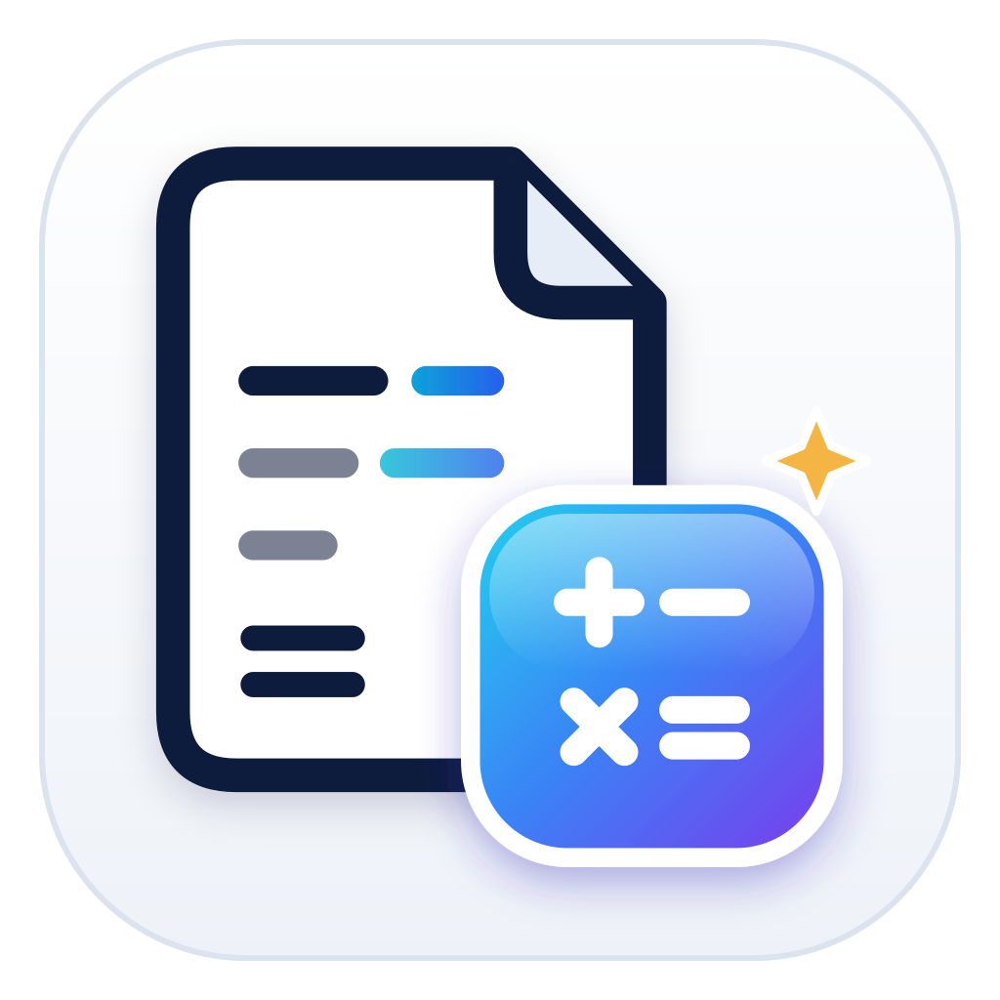

# GCP-Calc

**Calculadora em notas: escreva cálculos como você pensa e veja os resultados na hora — com moedas ao vivo, unidades, porcentagens, variáveis, gráficos e um assistente passo a passo.**

Livre · Gratuito · Sem anúncios · Linux, Windows, macOS e Android

[](https://github.com/cliqueprojeto/GCP-Calc/releases/latest)
[](https://github.com/cliqueprojeto/GCP-Calc/releases)
[](LICENSE)


**[⬇️ Baixar](#️-download-e-instalação)** · **[✨ Recursos](#-recursos)** · **[🖼️ Telas](#️-telas)** · **[📜 Versões](CHANGELOG.md)** · **[❤️ Apoie](#️-apoie-o-projeto)**

🇧🇷 Português · [🇺🇸 English](#-english) · [🇪🇸 Español](#-español)


</div>

---

## Sobre

O **GCP-Calc** faz parte da série de aplicativos **GCP** da [Gestão Cultural Pro](https://www.gestaoculturalpro.com.br). É uma calculadora em formato de notas: em vez de apertar teclas, você escreve linhas como `Aluguel: R$ 1.850`, `US$ 120 em reais` ou `5 km em milhas`, e o resultado aparece alinhado à direita, linha a linha, enquanto você digita.

As notas ficam no seu aparelho. Cotações, backup na nuvem, atualizações e IA são opcionais e só são usados quando você liga cada um.

## ✨ Recursos

| | Recurso | Destaques |
|---|---|---|
| 🧮 | **Cálculo em linguagem natural** | Português, inglês e espanhol · palavras soltas são ignoradas (`Aluguel 1.500 + condomínio 450`) · `+ − × ÷ ^ mod !` e também `mais`, `vezes`, `dividido por` · parênteses, multiplicação implícita (`2(3+4)`, `2 pi`) · `3k`, `2 mil`, `1,5 milhão` |
| 🔢 | **Separadores do seu idioma** | Vírgula ou ponto decimal ao digitar e nos resultados (automático pelo idioma ou fixo) · agrupamento de milhares · casas decimais configuráveis |
| 💱 | **Moedas ao vivo** | 160+ moedas (open.er-api.com / BCE), dólar comercial em reais (AwesomeAPI) e criptomoedas (BTC, ETH, SOL…) · símbolos (`R$`, `US$`, `€`, `£`, `¥`), códigos (`100 USD`) e nomes (`50 dólares`) · atualiza ao abrir o app e quando você pedir |
| 🏷️ | **Tags personalizadas** | Apelidos (`#verdinha → USD`) ou moedas próprias com cotação fixa (`#milhas = 0,02 BRL`) · `10.000 milhas em reais` |
| 📏 | **Conversor de unidades** | Comprimento, massa, área, volume, tempo, temperatura, dados, velocidade de internet, velocidade, energia, potência, pressão, ângulo e frequência · unidades compostas (`5 ft 3 in em cm`, `100 km / 2 h`, `3 m * 4 m` → m², `500 Mbps * 1 h em GB`) · medidas de cozinha (xícaras, colheres) |
| ％ | **Porcentagens** | `300 + 10%` · `300 − 10%` · `20% de 300` · `50 em % de 200` · `20% off 50` |
| 🧩 | **Variáveis, rótulos e funções** | `salario = R$ 7.500` · rótulos viram variáveis (`Aluguel: 1.500` → `Aluguel * 12`) · funções próprias (`f(x) = x^2 + 1`) · `total`, `média`, `prev`, `linha3` · `sqrt`, `round`, `log`, `ln`, trigonometria, `mdc`, `mmc`, `min`, `max` · financeiras `pmt` (parcela fixa / Price), `fv` (valor futuro), `pv` · hexadecimal, binário e notação científica |
| 🧮 | **Seções, moeda e autocompletar (como num editor de código)** | `#Receitas` abre uma seção e `#Receitas` numa conta vale a soma dela — lançamentos com `:` ou com `=` (`salário = R$ 1.000`) contam; o nome funciona com ou sem `#` (`receitas - despesas`) e `total` soma a seção inteira · `Total #Receitas` · `#Receitas - #Despesas` (despesas negativas ou positivas são descontadas) · `Sobra %` = sobra em % das receitas · `Flora: 2.000` numa seção em reais vira **R$ 2.000,00**; quantidades (`pessoas: 2`) continuam números · separadores de milhar entram enquanto você digita · **Enter** formata a linha (`-R$ 100,00`) e preenche `= …` · autocompletar de variáveis (com o valor), `#seções` e funções · receitas em verde, despesas em vermelho |
| 🗂️ | **Organizar com um clique** | Separa lançamentos em receitas e despesas, coloca a moeda, soma cada seção e calcula saldo e saldo % · prévia antes × depois · revisão opcional pela IA |
| 🎯 | **Previsto × Realizado** | `Cachê: R$ 5.000 \| R$ 4.200` (previsto \| realizado) mostra o realizado com selo de **% executado** (verde ao completar, vermelho ao estourar) · subseções `## Equipe` dentro de `# Despesas` somam na seção-mãe · `Previsto #Despesas`, `Realizado #Despesas`, `Saldo a executar #Equipe`, `% Executado`, `% A executar`, `Saldo` · no BI, tabela com previsto, realizado, saldo e % por grupo e rubrica · modelo pronto com dados fictícios |
| 📥 | **Importar planilhas e PDFs** | Excel, CSV, TXT, Markdown e PDF (orçamentos, planilhas de projetos culturais, prestações de contas) viram um bloco organizado: etapas e grupos como seções, quantidade × valor unitário, previsto \| realizado, totais e saldo · prévia antes de inserir como bloco ou nova nota |
| ➖ | **Totais mais inteligentes** | **Subtotal** do grupo (desde o título ou o subtotal anterior) · `Total a pagar`, `Total a receber`, `Lucro`, `Prejuízo`, `Saldo do mês` · `#Receitas - #Despesas` em vários formatos (`#Receitas-#Despesas`, `#Total (#Receitas - #Despesas)`, `#TOTAL`, `Saldo`) · `% Executado` e `% A executar` · “10 mil reais em 10 meses” vira `R$ 10.000 * 10 meses` · lançamentos citados com `#` em contas à parte (rascunho, prova) sem mexer nas seções · autocompletar com atalhos e lançamentos |
| 📈 | **Relatórios comparativos (BI)** | Bloco que compara notas salvas lado a lado (ex.: orçamento do mês passado × este mês): seções, lançamentos e saldo com variação em valor e %, verde quando melhora e vermelho quando piora · entra no PDF, Word, PowerPoint e Excel |
| 💻 | **Playground de código** | Bloco de código como um compilador online, dentro da nota: editor com cores, números de linha, indentação automática e pares · **▶ Rodar** (Ctrl+Enter) com terminal, entrada (stdin) e tempo de execução · **Python** (CPython completo), **JavaScript**, **TypeScript**, **SQL (SQLite)**, **HTML/CSS/JS** com prévia e **JSON** rodam embutidos — offline e no celular · no computador também **C, C++, Go, Rust, Java, Ruby, PHP, Bash e PowerShell** com os compiladores instalados · **lições de programação** prontas (estilo SoloLearn): explicação, código que roda e desafio |
| 🧾 | **Comprovantes nas despesas** | Fotografe cupons e notas fiscais pela câmera do celular (ou anexe arquivos e PDFs no computador), vários de uma vez, ligados à linha da despesa · miniaturas sob o bloco, visualizador ampliado, baixar e excluir · entram no PDF, Word e PowerPoint |
| 😀 | **Emojis com “/”** | Digite `/` numa linha para enfeitar com emojis e símbolos (busca em PT/EN/ES: `/mercado`, `/casa`, `/pago`) — `🛒 Arroz: R$ 27,90` continua sendo conta, variável e item da seção |
| 🎙️ | **Anotações por voz** | Toque no microfone (no teclado de operadores ou na barra do bloco) e fale: “comprei arroz por 27,90, café 18 e paguei a luz 150” · **transcrição offline embutida (Whisper, código aberto)** — sem internet e sem chave de IA, com opção de traduzir para o inglês · ou pela IA que você já usa (OpenAI, Groq, Gemini, Mistral) · valores falados por extenso viram números (“vinte e sete e noventa” → R$ 27,90) · vira linhas de cálculo (`Arroz: R$ 27,90`…) com prévia, mesmo sem IA · inserir, ou inserir e organizar · o áudio pode ficar salvo na nota para ouvir e transcrever depois |
| 🔔 | **Lembretes e notificações** | **A pagar ou a receber** (programe também recebimentos) · ao marcar **Pago** ou **Recebido**, o valor entra no bloco da nota ligada, na seção de despesas ou receitas, e conta nos totais e fórmulas · contas a vencer e compromissos com valor, data, hora e repetição (semanal, mensal, anual) · aviso N dias antes, no dia e se atrasar · **notificações do sistema** no Android (agendadas, chegam com o app fechado) e no Windows/macOS/Linux · central de notificações com **contador de não lidas**, lidas e **arquivadas** · calendário do mês, atrasados, próximos 7 dias e total a pagar · “marcar como pago” passa o lembrete para o próximo mês · escreva `Luz: R$ 150 vence 10/12` ou `Aluguel: R$ 1.800 vence dia 5` numa nota e crie o lembrete com um toque no sino |
| 🗣️ | **Fórmulas por voz e por escrita natural** | Diga ou escreva o pedido e o app monta a fórmula com as seções e variáveis da nota: “faça o total de receitas menos despesas” → `Saldo: #Receitas - #Despesas` · “média dos gastos”, “maior gasto”, “dez por cento das receitas”, “aluguel vezes 12”, “quanto sobra em porcentagem” · funciona com sinônimos (“receitas” encontra `#Ganhos`) · numa linha digitada, o botão **ƒx** transforma a frase em fórmula |
| 🎓 | **Tutor de programação com IA** | No playground: **Explicar** o código linha a linha na sua língua, **Corrigir** erros com explicação, criar **Desafios** no seu nível e **Verificar** a solução (compara a saída e dá retorno) |
| 🔐 | **Senha, recuperação e digital** | Senha para abrir o app (guardada só como hash PBKDF2), **código de recuperação** para salvar ao criar, opção de pedir ou não a senha, bloqueio automático depois de alguns minutos fora do app e **desbloqueio com a digital** do celular |
| 🧠 | **Entende receitas e despesas** | Vocabulário em PT/EN/ES com singular, plural e verbos: despesas = gastos, compras, dispêndios, débitos, pagamentos, custos, contas, boletos…; receitas = ganhos, recebimentos, vendas, lucro, faturamento, salário, honorários, prestação de serviços, cachê… · vale para as seções `#`, o Organizar, a voz e a IA · **o ditado entra na seção que já existe** (ex.: “comprei pão…” vai para a última linha de `#Gastos`, antes do total) |
| 🛡️ | **Permissões no primeiro uso** | Ao abrir pela primeira vez, o app explica e pede de uma vez **microfone e notificações**; a escolha fica salva e pode ser revista em *Configurações › Permissões* |
| 📅 | **Datas** | `hoje + 30 dias` · `25/12/2026 − hoje` · semanas, meses e anos no calendário |
| 🗂️ | **Notas organizadas** | Nome, cor e ícone (banco com toda a biblioteca **Lucide**, 1.500+ ícones com busca, e emojis) · pastas · fixar · lixeira por 30 dias · busca rápida `Ctrl+K` · modelos prontos |
| 📊 | **Elementos gráficos no bloco** | Gráficos de colunas, barras, pizza, rosca e linha gerados dos próprios cálculos · metas com barra de progresso · painel de cotações · destaques coloridos · imagens · adesivos · títulos e divisores |
| 🪄 | **Assistente passo a passo** | Não é um chat paralelo: aparece dentro da nota com botões contextuais e dinâmicos que vão perguntando (escolhas, número, texto) até gerar as linhas do cálculo, com prévia dos resultados antes de inserir |
| 🎨 | **Temas e cores da sintaxe** | Premium escuros e claros · paletas de editores de código no estilo Omarchy · clássicos · seguir o sistema · tema personalizado · cores de números, unidades, moedas, operadores, variáveis, funções, comentários, títulos, rótulos, datas, tags e resultados **configuráveis por tema** |
| 📤 | **Exportação premium** | **PNG** e **PDF iguais à tela** (foto exata da nota, sem barras e menus) · **PDF** com texto selecionável no visual do tema, fontes embutidas e sintaxe colorida · **Word (.docx)** e **PowerPoint (.pptx)** editáveis no mesmo estilo da tela, com tabelas e — no PowerPoint — gráficos nativos com as cores do tema · **Excel (.xlsx)** organizado: seções, descrições, valores com formato de moeda/%/data, totais como `SUM`/`AVERAGE`, variáveis como nomes definidos e expressões convertidas em fórmulas vivas · Excel com todas as notas e aba de resumo · todos os elementos gráficos (gráficos, metas, destaques, cotações, imagens e adesivos) |
| ☁️ | **Backup e sincronização** | Google Drive criptografado de ponta a ponta (AES-256-GCM) · sincronização automática entre aparelhos · backups datados com rotação · arquivo `.gcpcalc` com senha opcional |
| 🔄 | **Atualizações automáticas** | Direto das Releases do GitHub, com conferência de SHA-256 |

### Assistentes guiados (funcionam offline)

| Finanças | Dia a dia | Conversões |
|---|---|---|
| Juros compostos com aportes · Financiamento (parcelas fixas) · Orçamento 50/30/20 · Valor da hora (freelancer) | Dividir a conta com gorjeta · Desconto e acréscimo · Variação percentual · Regra de três · Combustível da viagem | Unidades (14 grandezas) · Moedas e criptomoedas |

**Comando `/ia` direto na nota:** em qualquer bloco de cálculo, digite `/ia` seguido da pergunta (ex.: `/ia quanto devo investir por mês para dobrar R$ 500?`) e aperte **Enter** — a IA escreve as linhas do cálculo ali mesmo, já calculadas. Se faltar algum dado essencial, o assistente abre com a pergunta dela em botões.

Com uma IA configurada, o assistente aceita qualquer pedido ("quanto juntar por mês para R$ 20 mil em 2 anos?"), explica a nota e revisa os cálculos — sempre com botões e prévia, sem sair da nota. Provedores suportados: **Anthropic, OpenAI, Google Gemini, Mistral, Groq, DeepSeek, xAI, OpenRouter, Ollama (local)** e qualquer API compatível com OpenAI. O botão **Testar API** confere a chave, lista os modelos e escolhe o melhor disponível. Se o provedor estiver sobrecarregado (erros 503/429), o app tenta de novo sozinho e, se preciso, usa outro modelo do mesmo provedor ou outro provedor configurado. A chave fica só no seu aparelho.

### Modelos prontos e modelos seus

**Programação (lições que rodam na nota):** Python: primeiros passos · JavaScript: fundamentos · SQL na prática · Algoritmos clássicos · HTML e CSS: primeira página · TypeScript: tipos na prática · C, Go e Rust no computador.

**Finanças e dia a dia:**

Orçamento do mês · Lista de compras · Gastos com pets · Dividir a conta · Viagem de carro · Churrasco e festa · Parcelado ou à vista? · Meta de economia · Volta às aulas · Viagem internacional (várias moedas) · Orçamento de projeto cultural (rubricas e limites percentuais) · Proposta de freelance · Receita escalável · Investimentos · Reforma e obra · Conversões rápidas.

**Crie, compartilhe e importe modelos:** qualquer nota vira modelo (menu ⋯ → *Salvar como modelo*) com nome, descrição, ícone e cor próprios, levando todos os blocos e gráficos. Compartilhe por um **código de texto** (`GCPCALC1:…`, cabe numa mensagem) ou um **arquivo `.gcptpl`**; quem recebe importa em *Modelos → Importar modelo*, vê a prévia e adiciona aos seus. Os modelos também sincronizam pelo Google Drive.

### Interface

- Visual premium, coeso com a série GCP, com ícone próprio: um cupom fiscal com selo de calculadora dourado sobre fundo esmeralda.
- Cursor preciso ao tocar ou clicar em qualquer ponto do texto (inclusive em títulos `#`), no computador e no Android.
- **Português, inglês e espanhol completos**, com detecção automática do idioma do sistema (troca rápida na barra superior).
- Resultado clicável: um clique copia o valor; o rodapé de cada bloco mostra soma e média.
- Teclado de operadores no celular, áreas seguras do Android (barra de status, gestos e teclado).
- Atalhos: `/ia` + Enter pergunta à IA · `Ctrl+K` busca · `Ctrl+N` nova nota · `Ctrl+J` assistente · `Ctrl+,` configurações · `Tab`/`Shift+Tab` recuam linhas.

### Atualizações automáticas

Novas versões chegam direto das [Releases do GitHub](https://github.com/cliqueprojeto/GCP-Calc/releases). Em **Configurações → Atualizações** você escolhe quando verificar:

> Sempre que abrir o programa · Todos os dias · A cada semana · A cada duas semanas · A cada mês · Nunca

Também dá para **verificar agora** e abrir a **página de versões**. Quando há novidade, o aplicativo mostra as notas da versão, baixa o pacote certo para o seu sistema (`.exe`, `.dmg`, `.deb`, `.rpm`, `.pkg.tar.zst` ou `.apk`), confere o SHA-256 e instala.

### Google Drive

Backup e sincronização na pasta oculta do aplicativo no Google Drive (escopo `drive.appdata`): o app não enxerga seus outros arquivos. Tudo é cifrado com AES-256-GCM antes de sair do aparelho, com chave derivada (PBKDF2-SHA256) da frase-senha que você escolhe — o Google só recebe dados ilegíveis. Detalhes em [docs/CLOUD-SETUP.md](docs/CLOUD-SETUP.md).

## ⬇️ Download e instalação

Baixe o arquivo do seu sistema na [página da última versão](https://github.com/cliqueprojeto/GCP-Calc/releases/latest).

| Sistema | Arquivo | Como instalar |
|---|---|---|
| **Windows 10/11** | `GCP-Calc-x.y.z-Windows-x64-Setup.exe` | Dê dois cliques. O aplicativo instala e abre sozinho. |
| **macOS Apple Silicon (M1, M2, M3, M4…)** | `GCP-Calc-x.y.z-macOS-arm64.dmg` | Abra o `.dmg` e arraste o GCP-Calc para **Aplicativos**. |
| **macOS Intel** | `GCP-Calc-x.y.z-macOS-x86_64.dmg` | Abra o `.dmg` e arraste o GCP-Calc para **Aplicativos**. |
| **Debian, Ubuntu, Mint, Zorin, Pop!_OS** | `gcp-calc_x.y.z_amd64.deb` | Dê dois cliques e escolha **Instalar**. |
| **Fedora, openSUSE, RHEL** | `gcp-calc-x.y.z-1.x86_64.rpm` | Dê dois cliques e escolha **Instalar**. |
| **Arch, BigLinux, Omarchy, Manjaro** | `gcp-calc-bin-x.y.z-1-x86_64.pkg.tar.zst` | Dê dois cliques (abre no gerenciador de pacotes) e confirme. |
| **Android 7+** | `GCP-Calc-x.y.z-Android.apk` | Abra o arquivo no celular e permita instalar de fontes desconhecidas. |

Cada arquivo vem com o seu `.sha256`, e a release traz `SHA256SUMS.txt`.

<details>
<summary><b>Instalar pelo terminal (Linux)</b></summary>

```bash
# Debian / Ubuntu / Mint
sudo apt install ./gcp-calc_*_amd64.deb

# Fedora
sudo dnf install ./gcp-calc-*.x86_64.rpm

# Arch / BigLinux / Omarchy / Manjaro
sudo pacman -U gcp-calc-bin-*-x86_64.pkg.tar.zst
```
</details>

<details>
<summary><b>Avisos de segurança no primeiro uso (Windows e macOS)</b></summary>

O GCP-Calc ainda não usa certificados pagos de assinatura de código, por isso o sistema pode exibir um aviso na primeira vez:

- **Windows (SmartScreen):** clique em **Mais informações → Executar assim mesmo**.
- **macOS:** clique com o botão direito no app em Aplicativos → **Abrir** → **Abrir**. Se aparecer "está danificado", rode no Terminal:
  ```bash
  xattr -cr "/Applications/GCP-Calc.app"
  ```
</details>

## 🖼️ Telas

| Previsto × Realizado no BI: saldo e % executado por grupo e rubrica | Importar planilha ou PDF e organizar num bloco |
|---|---|
| 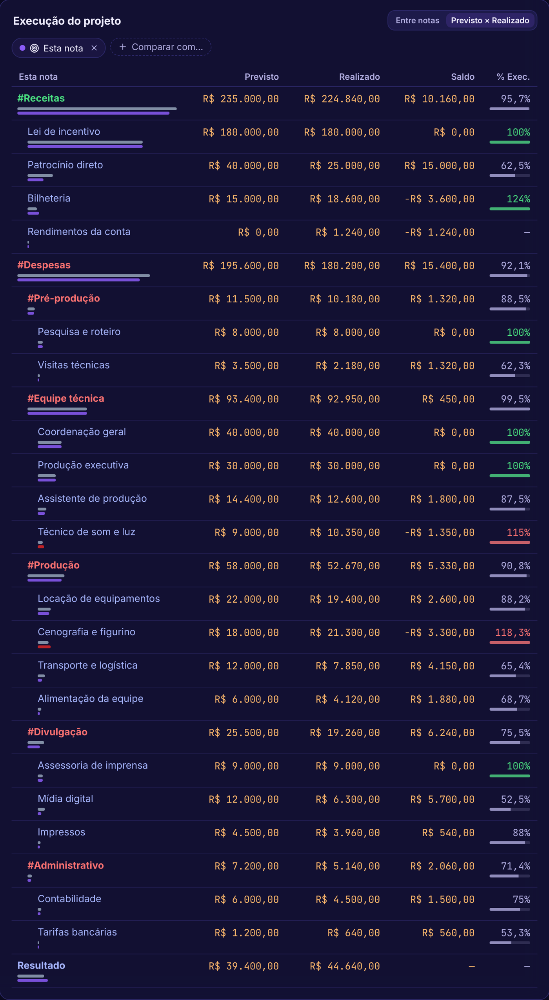 | 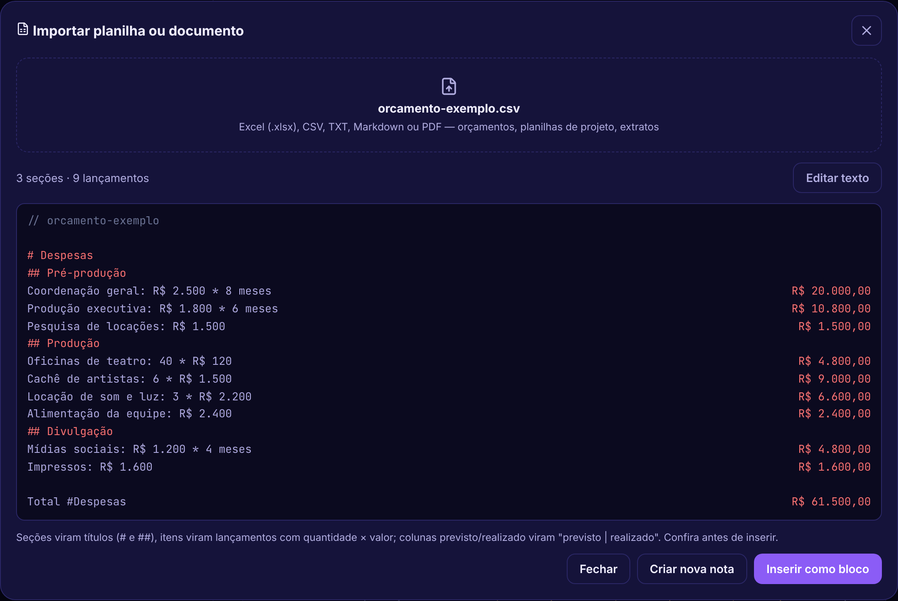 |
| **Playground de código: Python, SQL e mais, com terminal** | **Comprovantes fotografados ligados às despesas, com emojis** |
| 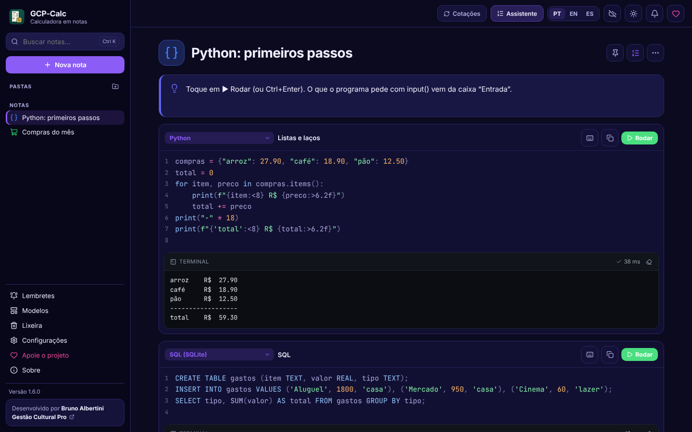 | 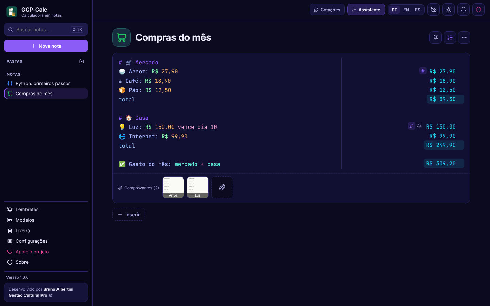 |
| **Lembretes: calendário, atrasados e total a pagar** | **Central de notificações com não lidas e arquivadas** |
| 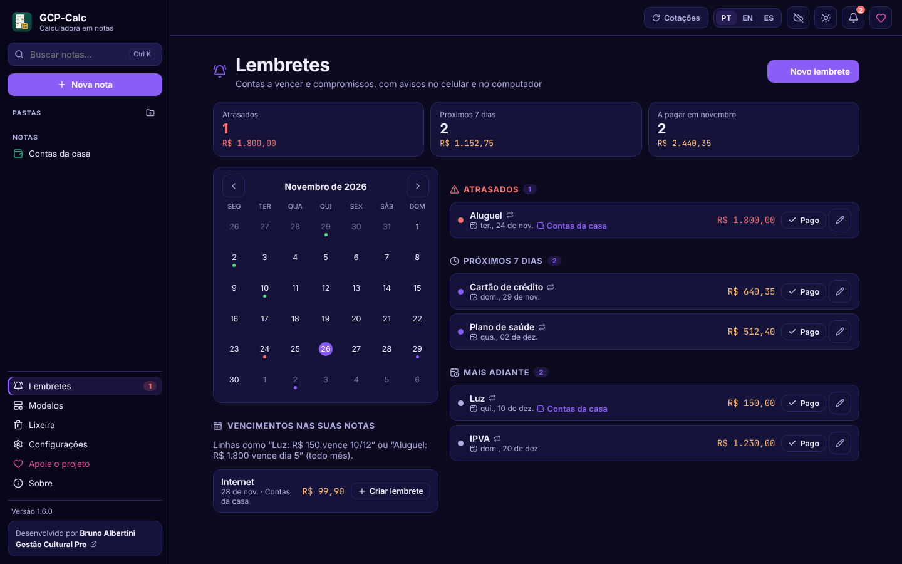 | 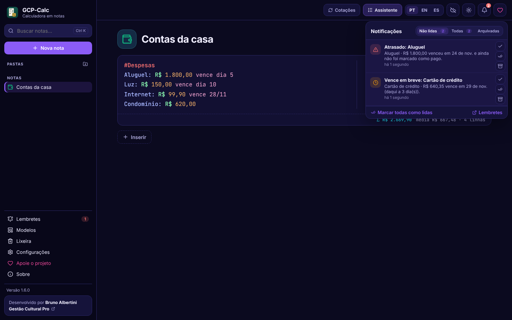 |
| **Seções #Receitas/#Despesas, moeda automática e cores** | **Relatório comparativo entre notas (BI)** |
| 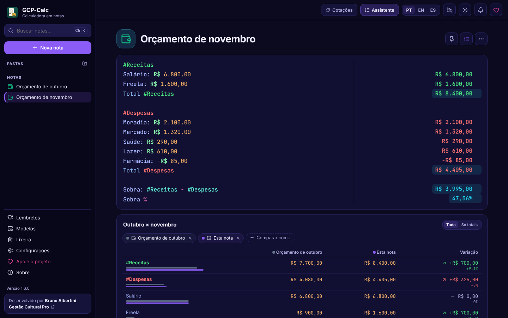 | 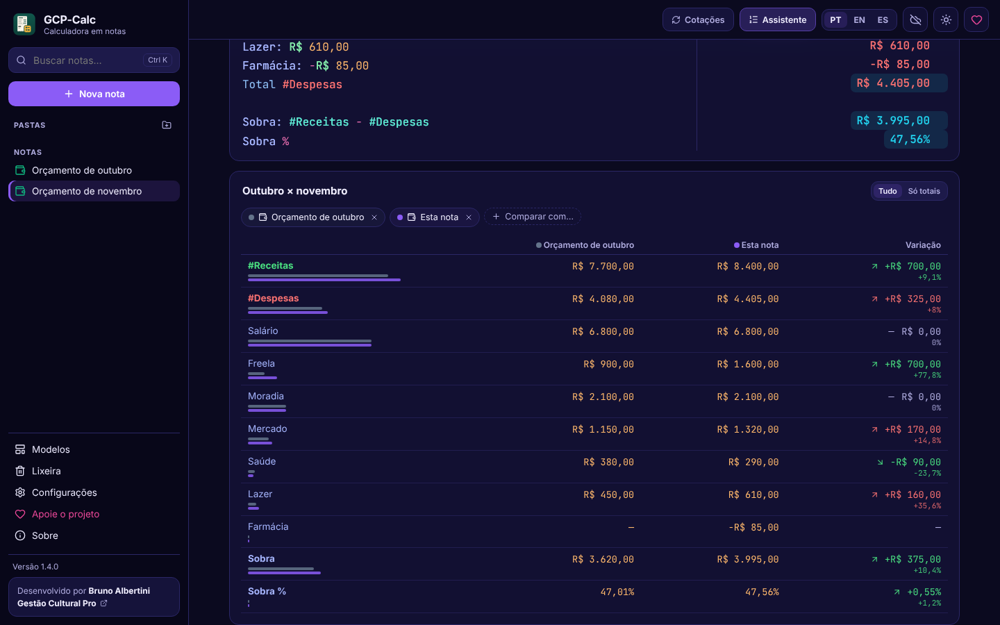 |
| **Moedas ao vivo, unidades, datas e funções** | **Gráficos gerados dos cálculos** |
| 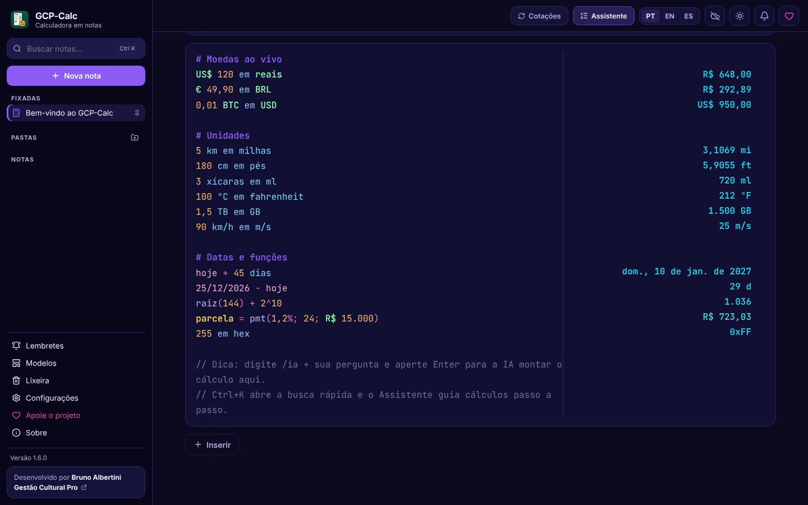 |  |
| **Assistente passo a passo** | **Assistente guiado: financiamento com prévia** |
|  |  |
| **Modelos prontos** | **Temas premium e de editores de código** |
| 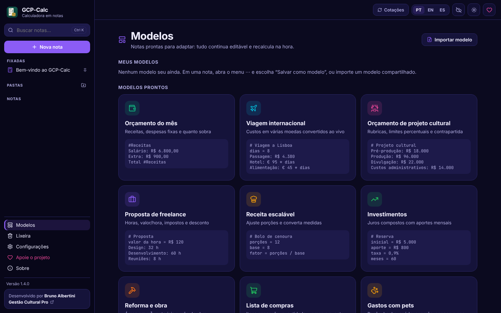 | 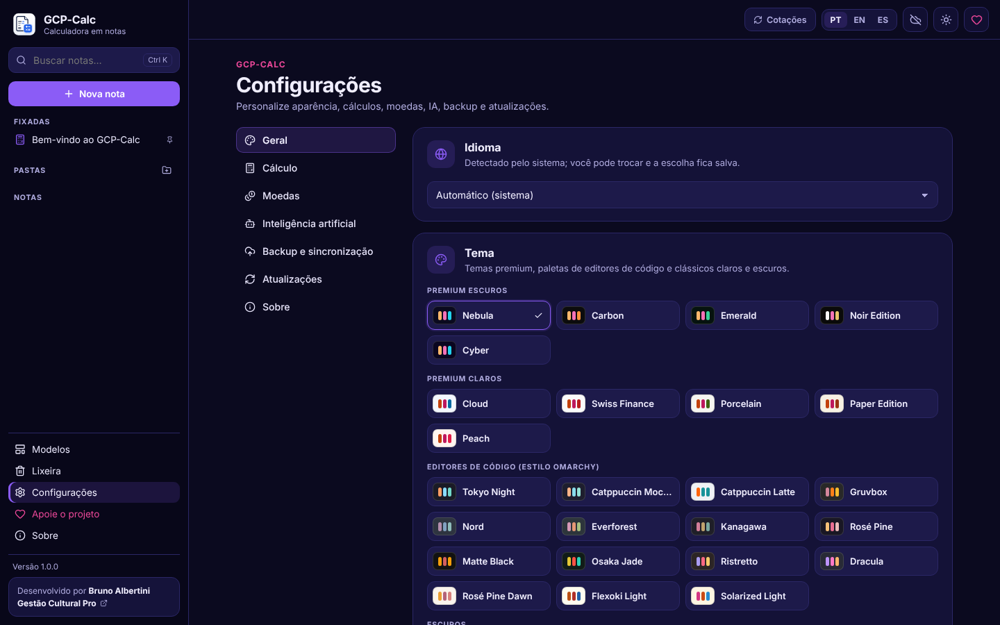 |
| **Cores da sintaxe configuráveis (Tokyo Night)** | **Moedas, cotações e tags personalizadas** |
|  |  |
| **Provedores de IA com teste de API** | **Backup e sincronização no Google Drive** |
|  |  |
| **Atualizações pelo GitHub** | **Apoie o projeto** |
| 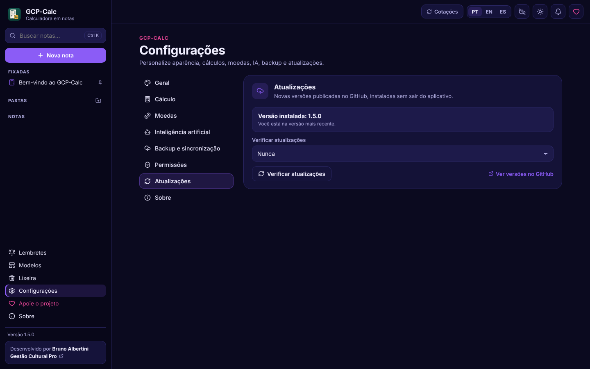 |  |
| **Tema claro (inglês)** | **Catppuccin (espanhol)** |
|  |  |

<div align="center">

**Android**

&nbsp;&nbsp;&nbsp;&nbsp;

</div>

## 📖 Guia rápido

```
# Títulos começam com #          // comentários com //
#Receitas                        seção: as linhas abaixo somam nela
Salário: R$ 3.000                rótulo + valor (o rótulo vira variável)
Flora: 2.000                     moeda da seção (→ R$ 2.000,00)
#Despesas
Médico: -R$ 2.000                negativas ou positivas, tanto faz
#Receitas - #Despesas =          Enter preenche o resultado
Luz: R$ 150 vence 10/12          vencimento → lembrete (sino ao lado do resultado)
Aluguel: R$ 1.800 vence dia 5    todo mês
Sobra %                          sobra em % das receitas
Subtotal                         soma o grupo desde o título ou o subtotal anterior
Total a pagar · Total a receber  todas as despesas · todas as receitas
Saldo   ·   % Executado          receitas − despesas · despesas em % das receitas
Cachê: R$ 5.000 | R$ 4.200       previsto | realizado (selo com % executado)
## Equipe                        subseção: soma também na seção de cima
Previsto #Despesas               também Realizado, Saldo a executar, % Executado
Aluguel: R$ 1.500                rótulo + valor (o rótulo vira variável)
x = 10 * 3                       variável
300 + 10%   ·   20% de 300       porcentagens
50 em % de 200                   quanto um valor representa
100 USD em BRL                   moedas ao vivo (e #suas_tags)
5 km em milhas                   unidades
hoje + 30 dias                   datas
total   ·   média   ·   prev     soma, média e resultado anterior do bloco
sqrt(16)   ·   round(3,14159; 2) funções (argumentos separados por ;)
pmt(1%; 24; R$ 10.000)           parcela fixa
f(x) = x^2 + 1                   função própria
255 em hex   ·   0b1010          bases numéricas
```

## 📜 Histórico de versões

As notas completas de cada versão estão no [CHANGELOG.md](CHANGELOG.md) e na [página de Releases](https://github.com/cliqueprojeto/GCP-Calc/releases).

## 🛠️ Desenvolvimento

Requisitos: Node.js 22, Rust estável e as [dependências do Tauri 2](https://tauri.app/start/prerequisites/) do seu sistema.

```bash
git clone https://github.com/cliqueprojeto/GCP-Calc.git
cd GCP-Calc
npm install
npm run tauri dev
```

| Comando | O que faz |
|---|---|
| `npm run tauri dev` | Abre o aplicativo nativo em modo de desenvolvimento |
| `npm run dev` | Abre só a interface no navegador |
| `npm test` | Testes do motor de cálculo, dos modelos e dos assistentes (PT/EN/ES) |
| `npm run typecheck` | Verificação de tipos |
| `npm run tauri build` | Gera os instaladores do seu sistema |
| `node scripts/screenshots.mjs` | Recria as capturas de tela (com `vite preview` na porta 4173) |
| `node scripts/android-icons.mjs` | Recria o ícone adaptativo do Android |

### Publicar uma nova versão

1. Atualize a versão em `package.json`, `src-tauri/tauri.conf.json` e `src-tauri/Cargo.toml`, e adicione a seção no `CHANGELOG.md`.
2. Crie `docs/release-notes/vX.Y.Z.md` e envie para a branch `main`.
3. O GitHub Actions compila para Linux (`.deb`, `.rpm`, `.pkg.tar.zst`), Windows, macOS (Intel e Apple Silicon) e Android, gera os SHA-256 e publica a Release. Os aplicativos instalados detectam a nova versão sozinhos.

Segredos do repositório usados no build: `GOOGLE_CLIENT_ID`, `GOOGLE_CLIENT_SECRET` (Google Drive) e `ANDROID_KEYSTORE_BASE64`, `ANDROID_KEYSTORE_PASSWORD`, `ANDROID_KEY_ALIAS`, `ANDROID_KEY_PASSWORD` (assinatura do APK).

### Estrutura

```
src/
  engine/            motor de cálculo: lexer, parser, unidades, moedas e formatação
  components/        interface (editor, blocos gráficos, assistente, configurações…)
  ai/                provedores de IA, protocolo do assistente e assistentes offline
  cloud/             OAuth com PKCE, Google Drive, sincronização e criptografia
  lib/               temas, ícones, cotações, atualizador e ponte com o sistema
  i18n/              traduções (pt-BR, en, es)
  notes/             nota de boas-vindas e modelos
src-tauri/           núcleo nativo (Rust): dados com gravação atômica, OAuth e atualizações
packaging/           pacote Arch e atividade/ícones do Android
assets/branding/     ícone do aplicativo (SVG/PNG)
scripts/             capturas de tela e ícones
tests/               testes do motor
```

## ❤️ Apoie o projeto

O GCP-Calc é livre e gratuito. Sua contribuição ajuda a mantê-lo aberto e em evolução. Todas as funções estão disponíveis sem contribuição. Também dá para apoiar pelo botão ❤️ dentro do aplicativo.

<table>
<tr>
<td align="center" width="50%">

**PIX · Brasil**


<details><summary>Código PIX copia e cola</summary>

```
00020126850014br.gov.bcb.pix0136e474b71b-7491-4eac-992f-632652e5a4eb0223DEV GESTAO CULTURAL PRO5204000053039865802BR5915BRUNO ALBERTINI6006BRASIL62200516ChromeExtensions63042B27
```
</details>

</td>
<td align="center" width="50%">

**Stripe · Internacional**

Contribua com qualquer valor pelo checkout seguro do Stripe.

**[💜 Contribuir via Stripe](https://donate.stripe.com/fZu4gzeBSfhbd7451F6Ri00)**

</td>
</tr>
</table>

## 📄 Licenças

- **GCP-Calc:** [GNU General Public License v3.0](LICENSE) ou posterior.
- **Componentes de terceiros** (Tauri, React, Zustand, Lucide, jsPDF, docx, PptxGenJS, ExcelJS, node-qrcode, fontes Inter, JetBrains Mono, IBM Plex Mono, Fira Code, Roboto, Atkinson Hyperlegible e outros) e serviços consultados: veja [THIRD_PARTY_NOTICES.md](THIRD_PARTY_NOTICES.md).

As marcas e nomes citados (Google Drive, provedores de IA, paletas de editores etc.) pertencem aos seus titulares e aparecem apenas como referência de compatibilidade.

---

## 🇺🇸 English

**GCP-Calc** is a free, ad-free **notes calculator** for Linux, Windows, macOS (Apple Silicon and Intel) and Android: write calculations the way you think and see results instantly, line by line.

- **Natural language** in English, Portuguese and Spanish; free words are ignored (`Rent 1,500 + utilities 450`). Your language's decimal and thousands separators.
- **Live currencies** (160+ currencies and crypto), refreshed when the app opens and on demand, plus **custom tags** (aliases or your own currencies with a fixed rate).
- **Unit conversion** across 14 dimensions, including compound units (`5 ft 3 in in cm`, `100 km / 2 h`).
- **Sections like a code editor**: `#Income` opens a section and `#Income` in a formula is its sum (`Total #Income`, `#Income - #Expenses`, `Balance %`); plain numbers inherit the section's currency, quantities stay numbers; thousands separators appear while you type, Enter formats the line; autocomplete for variables, `#sections` and functions; income in green, expenses in red. **Organize** rewrites a block into income/expenses with totals (optional AI review).
- **Code playground**: a code block that works like an online compiler inside the note — run Python, JavaScript, TypeScript, SQL (SQLite), HTML/CSS/JS and JSON offline, even on the phone; on desktop also C, C++, Go, Rust, Java, Ruby, PHP, Bash and PowerShell with your installed toolchains. Includes programming lessons (explanation, runnable code and a challenge).
- **Receipts**: photograph receipts with the phone camera (or attach files/PDFs on desktop) and link them to expense lines; view, download and include them in exports.
- **Type `/`** to add emojis and symbols to lines without breaking the math. **Offline voice transcription** with built-in open-source Whisper (no internet, no AI key).
- **Voice notes**: tap the mic and say what you bought; it's transcribed (OpenAI, Groq, Gemini or Mistral, or live dictation where available), turned into calculation lines with a preview, and the audio can be kept in the note.
- **Reminders and notifications**: to pay or to receive; marking one **Paid** or **Received** adds the amount to the linked note's block, in the expenses or income section, so it counts in totals and formulas. Bills and commitments with amount, date, repeat and early alerts; system notifications on Android (scheduled, even with the app closed) and desktop; notification center with unread count and archive; month calendar; write `Power: $150 due 12/10` in a note and turn it into a reminder with one tap. All permissions are requested together on first launch and remembered.
- **Comparison reports (BI)**: a block that compares saved notes side by side (e.g. last month's budget × this month), with change in value and %.
- **Subtotals and quick totals**: `Subtotal` adds only the group since the heading or the previous subtotal; `Total to pay`, `Total to receive`, `Profit`, `Balance`.
- **Planned × Actual**: write `Fee: $5,000 | $4,200` (planned | actual) to get a % executed badge per line, `## Crew` subsections that roll up into `# Expenses`, ready lines (`Planned #Expenses`, `Actual #Expenses`, `% Executed`, `Balance`) and a Planned × Actual BI table with balance and % per group.
- **Import spreadsheets and PDFs** (Excel, CSV, TXT, Markdown, PDF): stages and groups become sections, rows become quantity × price entries, with totals and a preview before inserting.
- **Your own templates**: save any note as a template with its own icon and color, share it as a text code or `.gcptpl` file, and import templates from other people. New built-ins: shopping list, pets, split the bill, road trip, BBQ, installments vs. cash, savings goal, back to school.
- **Percentages** (`300 + 10%`, `20% of 300`, `50 as % of 200`), **variables**, labels, custom functions, `total`/`average`/`prev`, dates, `pmt`/`fv`/`pv`, hex and binary.
- **Notes with name, color and icon** (1,500+ Lucide icons and emoji), folders, trash, templates and quick search (`Ctrl+K`).
- **Graphic blocks**: charts built from your calculations, goals with progress bars, rates board, callouts, images, stickers.
- **`/ia` command**: type `/ia` + your question in any block and press Enter — the AI writes the calculation lines right there.
- **Step-by-step assistant** inside the note (not a side chat): contextual buttons, choices and fields until the calculation lines are ready, with a live preview. 11 guided assistants work offline; optional AI (Anthropic, OpenAI, Gemini, Mistral, Groq, DeepSeek, xAI, OpenRouter, Ollama or any OpenAI-compatible API) with an API test button.
- **Themes**: premium, Omarchy-style code-editor palettes, classic light/dark, follow system and custom; **syntax colors configurable per theme**.
- **Premium export**: PNG and PDF exactly as on screen, PDF with selectable text in the theme's look, editable Word and PowerPoint (native charts), and a smartly organized Excel (sections, formats, SUM/AVERAGE formulas, named variables and live formulas) — with all graphic elements.
- **End-to-end encrypted Google Drive backup and sync** and `.gcpcalc` file backups.
- **Automatic updates** from GitHub Releases (on startup, daily, weekly, every two weeks, monthly or never).

**Install:** download your file from the [latest release](https://github.com/cliqueprojeto/GCP-Calc/releases/latest) (see the table above).

## 🇪🇸 Español

**GCP-Calc** es una **calculadora en notas** gratuita y sin anuncios para Linux, Windows, macOS (Apple Silicon e Intel) y Android: escribe cálculos como piensas y ve los resultados al instante, línea por línea.

- **Lenguaje natural** en español, portugués e inglés; las palabras sueltas se ignoran (`Alquiler 1.500 + luz 450`). Separadores decimales y de miles de tu idioma.
- **Monedas en vivo** (160+ monedas y criptomonedas), actualizadas al abrir la app y cuando lo pidas, y **tags personalizados** (alias o monedas propias con cotización fija).
- **Conversión de unidades** en 14 magnitudes, incluso compuestas (`5 ft 3 in en cm`, `100 km / 2 h`).
- **Secciones como en un editor de código**: `#Ingresos` abre una sección y `#Ingresos` en una fórmula es su suma (`Total #Ingresos`, `#Ingresos - #Gastos`, `Saldo %`); los números sueltos toman la moneda de la sección y las cantidades siguen siendo números; separadores de miles al escribir, Enter formatea la línea; autocompletar de variables, `#secciones` y funciones; ingresos en verde y gastos en rojo. **Organizar** reescribe un bloque en ingresos/gastos con totales (revisión opcional por IA).
- **Playground de código**: un bloque que funciona como compilador online dentro de la nota — Python, JavaScript, TypeScript, SQL (SQLite), HTML/CSS/JS y JSON sin conexión, incluso en el móvil; en el ordenador también C, C++, Go, Rust, Java, Ruby, PHP, Bash y PowerShell con tus compiladores. Incluye lecciones de programación.
- **Comprobantes**: fotografía tickets con la cámara del móvil (o adjunta archivos/PDF en el ordenador) y vincúlalos a los gastos; ver, descargar e incluir en las exportaciones.
- **Escribe `/`** para añadir emojis y símbolos sin romper los cálculos. **Transcripción de voz sin conexión** con Whisper integrado (código abierto, sin internet ni clave de IA).
- **Notas de voz**: toca el micrófono y di lo que compraste; se transcribe (OpenAI, Groq, Gemini o Mistral, o dictado en vivo donde exista), se convierte en líneas de cálculo con vista previa y el audio puede quedar en la nota.
- **Recordatorios y notificaciones**: cuentas y compromisos con valor, fecha, repetición y aviso previo; notificaciones del sistema en Android (programadas, incluso con la app cerrada) y en el escritorio; centro de notificaciones con no leídas y archivadas; calendario del mes; escribe `Luz: € 60 vence 10/12` en una nota y crea el recordatorio con un toque. Todos los permisos se piden juntos al abrir la app por primera vez y se recuerdan.
- **Informes comparativos (BI)**: un bloque que compara notas guardadas lado a lado (ej.: presupuesto del mes pasado × este mes), con variación en valor y %.
- **Subtotales y atajos**: `Subtotal` suma solo el grupo desde el título o el subtotal anterior; `Total por pagar`, `Total por cobrar`, `Ganancia`, `Saldo`. Recordatorios **por pagar o por cobrar**: al marcarlos como pagados o recibidos, el valor entra en el bloque de la nota vinculada.
- **Previsto × Realizado**: escribe `Caché: € 5.000 | € 4.200` (previsto | realizado) para ver el % ejecutado por línea, subsecciones `## Equipo` que suman en `# Gastos`, líneas listas (`Previsto #Gastos`, `Realizado #Gastos`, `% Ejecutado`, `Saldo`) y una tabla BI con saldo y % por grupo.
- **Importar hojas y PDF** (Excel, CSV, TXT, Markdown, PDF): etapas y grupos se vuelven secciones, las filas partidas con cantidad × precio, con totales y vista previa antes de insertar.
- **Plantillas propias**: guarda cualquier nota como plantilla con icono y color, compártela como código de texto o archivo `.gcptpl` e importa plantillas de otras personas. Nuevas incluidas: lista de compras, mascotas, dividir la cuenta, viaje en coche, asado, a plazos o al contado, meta de ahorro, vuelta al cole.
- **Porcentajes** (`300 + 10%`, `20% de 300`, `50 en % de 200`), **variables**, etiquetas, funciones propias, `total`/`promedio`/`prev`, fechas, `pmt`/`fv`/`pv`, hexadecimal y binario.
- **Notas con nombre, color e icono** (1.500+ iconos Lucide y emojis), carpetas, papelera, plantillas y búsqueda rápida (`Ctrl+K`).
- **Bloques gráficos**: gráficos generados de tus cálculos, metas con progreso, panel de cotizaciones, destacados, imágenes y pegatinas.
- **Comando `/ia`**: escribe `/ia` + tu pregunta en cualquier bloque y pulsa Enter — la IA escribe las líneas del cálculo ahí mismo.
- **Asistente paso a paso** dentro de la nota (no es un chat aparte): botones contextuales, opciones y campos hasta armar las líneas del cálculo, con vista previa. 11 asistentes guiados funcionan sin conexión; IA opcional (Anthropic, OpenAI, Gemini, Mistral, Groq, DeepSeek, xAI, OpenRouter, Ollama o cualquier API compatible con OpenAI) con botón para probar la API.
- **Temas**: premium, paletas de editores de código estilo Omarchy, clásicos claros/oscuros, seguir el sistema y personalizado; **colores de la sintaxis configurables por tema**.
- **Exportación premium**: PNG y PDF idénticos a la pantalla, PDF con texto seleccionable con el estilo del tema, Word y PowerPoint editables (gráficos nativos) y Excel organizado de forma inteligente (secciones, formatos, fórmulas SUM/AVERAGE, variables con nombre y fórmulas vivas), con todos los elementos gráficos.
- **Copia y sincronización cifradas en Google Drive** y copias en archivo `.gcpcalc`.
- **Actualizaciones automáticas** desde GitHub Releases.

**Instalación:** descarga tu archivo en la [última versión](https://github.com/cliqueprojeto/GCP-Calc/releases/latest) (ver la tabla de arriba).

---

<div align="center">

Desenvolvido por **[Bruno Albertini | Gestão Cultural Pro](https://www.gestaoculturalpro.com.br)**

<sub>Série GCP · <a href="https://github.com/cliqueprojeto">github.com/cliqueprojeto</a></sub>

</div>
